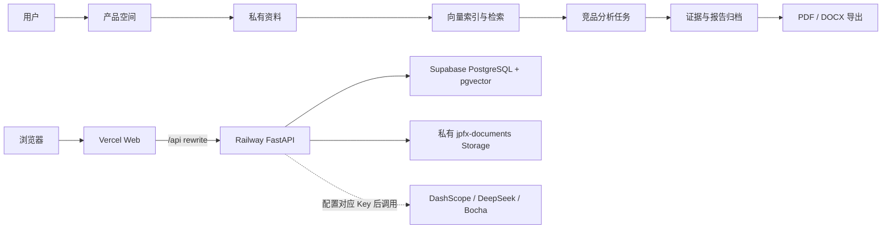
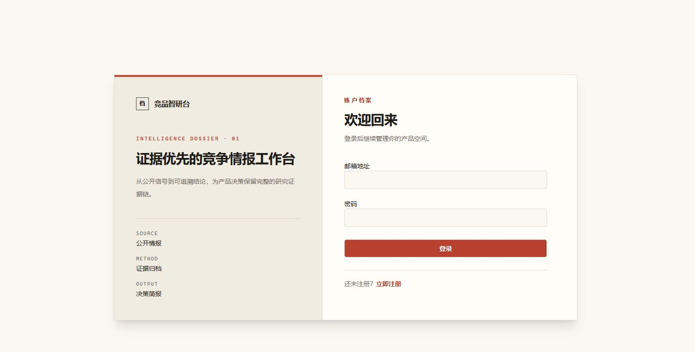
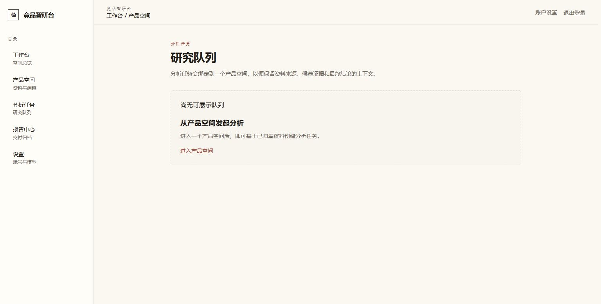
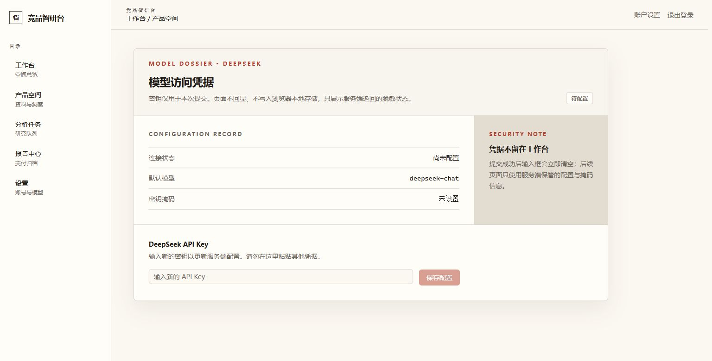

# JPFX｜AI 竞品研究工作台

> 面向 AI 产品经理的私有竞品研究工作台：把资料沉淀、RAG 检索、竞品分析任务、证据归档和报告导出串成一条可追溯工作流。

[在线体验](https://jpfx.vercel.app/) · [产品需求](PRD.md) · [技术设计](TECH_SPEC.md) · [任务拆分](TASK_BREAKDOWN.md)

[](https://github.com/904483446/jpfx/actions/workflows/ci.yml)

## 产品闭环

产品空间 → 私有资料 → 向量索引与检索 → 竞品分析任务 → 证据与报告归档 → PDF/DOCX 导出



浏览器经 Vercel 的 `/api` rewrite 访问 Railway FastAPI。后端负责认证、用户与产品空间隔离、资料处理、向量检索、任务与报告；数据使用 Supabase PostgreSQL + pgvector，文件存入私有 `jpfx-documents` Storage bucket。DashScope、DeepSeek、Bocha 仅在配置对应 Key 后才会被调用。

## 正式环境已验证

- Vercel 前端可通过 `/api` 转发访问 Railway FastAPI health。
- 已验证注册、登录与 httpOnly Cookie 会话。
- 已验证产品空间创建与访问。
- 已验证私有文档上传，以及 Supabase Storage 文件在 Railway 重部署后保留。
- 已验证使用 DashScope 完成文档索引。
- 已验证文档删除。

DeepSeek 分析与 Bocha 检索均已实现配置入口，但尚未进行生产环境真实调用验收。

## 产品界面

以下均为真实脱敏截图，不包含真实凭据或 API Key。

### 登录与安全会话



使用账号登录后，客户端通过 httpOnly Cookie 保持会话。

### 工作台与空间入口


从工作台进入产品空间，集中管理资料、任务与报告。

### 分析任务与报告



任务状态、证据与报告归档在同一工作流中可追溯。

### 用户级模型设置



在设置页查看 Provider 配置状态；前端不展示或保存真实密钥。

## 能力边界

### 已实现并已验证

| 能力 | 说明 |
| --- | --- |
| 认证与空间 | 注册、登录、httpOnly Cookie 会话、产品空间与用户/空间隔离。 |
| 私有资料 | 文档上传、DashScope 索引、删除，以及 Railway 重部署后的 Supabase Storage 保留。 |

### 已实现，需 Provider 配置或后续真实验收

| 能力 | 调用条件 |
| --- | --- |
| DashScope | 配置 Key 后用于文档向量索引。 |
| DeepSeek | 配置用户级模型 Key 后可用于竞品分析；尚未完成生产真实调用验收。 |
| Bocha | 配置后端 Key 后可用于检索；尚未完成生产真实调用验收。 |
| 向量检索、证据与报告归档、PDF/DOCX 导出 | 功能已实现，但未列入本次生产环境真实验收范围。 |

### 安全边界

- 会话采用 httpOnly Cookie；浏览器不直接持有 Supabase Storage 的访问凭据。
- 资料、检索、任务和报告按用户与产品空间隔离。
- 文件存放在私有 `jpfx-documents` bucket，由后端统一访问。
- Supabase Storage 的后端专用 Secret Key 仅保存在服务端安全配置中，不写入仓库、前端或截图。

## 技术架构

| 层级 | 技术与职责 |
| --- | --- |
| Web | Next.js、React、TypeScript、Tailwind CSS、shadcn/ui；部署在 Vercel。 |
| API | FastAPI、Pydantic、SQLAlchemy、Alembic；部署在 Railway，并承载认证、业务 API 与 Provider 调用。 |
| 数据 | Supabase PostgreSQL + pgvector，保存业务数据、向量与检索索引。 |
| 文件 | Supabase Storage 私有 bucket `jpfx-documents`，保存空间内文档。 |

## 本地启动与测试

仅以根目录的 [`.env.example`](.env.example) 作为环境变量示例。复制后创建本地 `.env`，不要提交任何真实凭据、Cookie、Token 或 Secret Key。

```powershell
# 仓库根目录：启动本地数据库
docker compose up -d --wait db

# 后端：迁移并启动 FastAPI
cd services/api
.\.venv\Scripts\python.exe -m alembic upgrade head
.\.venv\Scripts\python.exe -m uvicorn app.main:app --reload

# 前端：本地地址按根目录 .env.example 配置后启动
cd ../../apps/web
npm.cmd ci
npm.cmd run dev
```

常用检查命令：

```powershell
# 后端（services/api）
cd services/api
.\.venv\Scripts\python.exe -m ruff check --no-cache .
.\.venv\Scripts\python.exe -m ruff format --check --no-cache .
.\.venv\Scripts\python.exe -m pytest -q

# 前端（apps/web）
cd ../../apps/web
npm.cmd run test
npm.cmd run check:routes
npx.cmd tsc --noEmit
npm.cmd run lint
npm.cmd run build
```

## 项目文档

- [PRD.md](PRD.md)：产品范围与目标用户。
- [TECH_SPEC.md](TECH_SPEC.md)：技术设计、架构与边界。
- [TASK_BREAKDOWN.md](TASK_BREAKDOWN.md)：版本任务与演进记录。
