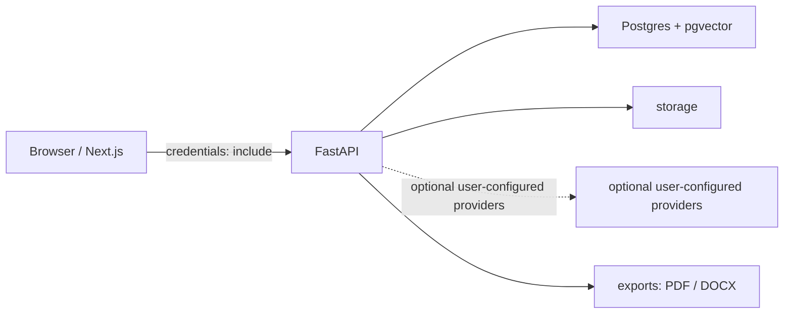

# AI Competitor Intelligence Workspace

面向 AI 产品经理的私有竞品研究工作台：在一个受用户与产品空间隔离的流程中，沉淀资料、检索证据、完成竞品分析，并归档可导出的报告。

> 当前仓库用于展示已合并的本地实现；公开 Demo 尚未提供，生产部署与真实第三方服务联调均属后续验证范围。

## 产品流程

`产品空间 → 私有资料 / RAG → 竞品分析任务 → 证据与报告归档 → PDF / DOCX 导出`



浏览器通过携带凭据的请求访问 FastAPI；服务端负责鉴权、空间隔离、资料与向量检索、任务和报告。外部模型、检索服务仅在用户或运行环境完成相应配置时才会被调用。

## 已合并能力

| 能力 | 已合并实现 |
| --- | --- |
| 身份与空间 | 注册、登录、登出、httpOnly Cookie 会话、当前用户校验，以及按用户归属的产品空间与默认知识库。 |
| 私有资料 | 空间内 PDF、DOCX、TXT、Markdown 上传、列表、删除、状态与失败原因展示。 |
| RAG 检索 | 文本解析与切分、`pgvector` 向量索引，以及按当前用户和产品空间过滤的检索结果与来源展示。 |
| 竞品分析 | 已知竞品输入、候选竞品确认、后台任务状态轮询与失败重试。 |
| 证据与报告 | 基于受限证据的结构化中文报告、报告详情、历史报告列表与按空间归档。 |
| 交付导出 | 报告 PDF / DOCX 导出，并附带可用的证据链接。 |
| 前端体验 | 首页、认证、应用壳、资料、检索、任务、报告与模型设置页面，以及加载、空态、错误和键盘焦点状态。 |

## 本地启动

仅使用仓库中的 [`.env.example`](.env.example) 作为环境变量说明；不要提交真实 `.env`、`apps/web/.env.local`、密钥、Cookie 或 Token。

1. 按 [`.env.example`](.env.example) 创建本地 `.env`。该文件为 Docker PostgreSQL + pgvector 与后端提供本地配置；不要展示或提交其中的真实值。按需配置变量名：`JWT_SECRET`、`DATABASE_URL`、`TEST_DATABASE_URL`、`CORS_ALLOWED_ORIGINS`、`AUTH_COOKIE_SECURE`。
2. 从仓库根目录启动本地 PostgreSQL + pgvector：

   ```powershell
   docker compose up -d db
   ```

3. 在启动 FastAPI 前执行数据库迁移：

   ```powershell
   cd services/api
   ./.venv/Scripts/python.exe -m alembic upgrade head
   ```

4. 在 `apps/web/.env.local` 中设置变量名 `NEXT_PUBLIC_API_BASE_URL`。
5. 分别启动后端和前端：

```powershell
# 终端 1：后端
cd services/api
.\.venv\Scripts\python.exe -m uvicorn app.main:app --reload

# 终端 2：前端
cd apps/web
npm.cmd ci
npm.cmd run dev
```

后端健康检查地址：`http://127.0.0.1:8000/api/v1/health`。

常用本地检查：

```powershell
# 后端（services/api）
.\.venv\Scripts\python.exe -m ruff check --no-cache .
.\.venv\Scripts\python.exe -m ruff format --check --no-cache .
.\.venv\Scripts\python.exe -m pytest -q

# 前端（apps/web）
npm.cmd run test
npm.cmd run check:routes
npx.cmd tsc --noEmit
npm.cmd run lint
npm.cmd run build
```

## 已验证

- 已合并的后端与前端自动化门禁曾在本地通过；其中包含测试、路由检查、类型检查、lint 与前端构建。
- 代码中已实现凭据携带、Cookie 会话、用户与产品空间过滤、PostgreSQL + pgvector 访问、资料存储路径隔离、报告归档与 PDF / DOCX 导出。
- 真实配置值不写入本仓库：用户配置的模型密钥只以加密或脱敏状态参与实现，前端不保存或返回该密钥。

## 未验证 / 后续工作

- 真实浏览器中的 Cookie / CORS 联调尚未作为当前 README 的验证结论。
- Docker、Alembic 与真实 PostgreSQL/pgvector 的端到端运行尚需在目标环境复核。
- DashScope、DeepSeek、Bocha 等外部 Provider 的真实请求取决于用户或环境完成配置；当前不宣称已验证。
- 本仓库未提供公开 Demo；生产部署、视觉验收与公开展示材料属于后续工作。

## 技术边界

- 前端：Next.js、React、TypeScript、Tailwind CSS、shadcn/ui。
- 后端：FastAPI、Pydantic、SQLAlchemy、Alembic。
- 数据：PostgreSQL、pgvector 与受空间隔离的资料存储。
- 外部能力：模型、嵌入和检索 Provider 为可选配置，不包含任何真实凭据。

## 项目文档

- [PRD.md](PRD.md)：产品范围与目标用户。
- [TECH_SPEC.md](TECH_SPEC.md)：技术设计与边界。
- [TASK_BREAKDOWN.md](TASK_BREAKDOWN.md)：版本任务与演进记录。
