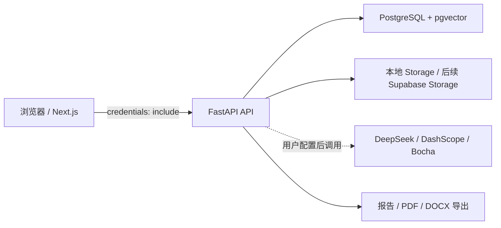

# V1.0 轻量 GitHub 展示材料 Implementation Plan

> **For agentic workers:** REQUIRED SUB-SKILL: Use superpowers:subagent-driven-development (recommended) or superpowers:executing-plans to implement this plan task-by-task. Steps use checkbox (`- [x]`) syntax for tracking.

**Goal:** 用可信的 README、静态架构图和真实页面截图，将 JPFX 呈现为可理解、可本地复现的 GitHub 项目。

**Architecture:** 展示材料以根目录 `README.md` 为唯一入口，Mermaid 架构图直接内嵌以避免维护独立二进制图源。截图作为受版本控制的 PNG 资产放在 `docs/assets/v1-showcase/`，每张图只展示已实现且可在本地验证的界面。

**Tech Stack:** Markdown、GitHub Mermaid、PNG 截图、Next.js 现有本地页面、FastAPI 本地 API。

---

## 文件结构

- 修改：`README.md` — 项目叙事、架构图、截图预览、启动、验证边界和路线图。
- 创建：`docs/assets/v1-showcase/login-v2.png` — 脱敏后的登录或注册页截图。
- 创建：`docs/assets/v1-showcase/dashboard-v2.png` — 脱敏后的工作台截图。
- 创建：`docs/assets/v1-showcase/task-or-report-v2.png` — 脱敏后的任务状态或报告页面截图。
- 创建：`docs/assets/v1-showcase/settings-v2.png` — 仅展示脱敏配置状态的设置页截图。

### Task 1: 重构 README 的展示叙事

**Files:**

- Modify: `README.md`

- [x] **Step 1: 记录当前 README 基线**

Run:

```powershell
rg -n '^#|^##' README.md
```

Expected: 现有 README 包含项目定位、技术栈、当前阶段、本地开发要求和环境变量章节。

- [x] **Step 2: 写入项目定位、研究流程和能力边界**

将 README 顶部替换为中文项目名与一句话定位，并在“核心流程”中使用：

```text
产品空间 → 私有资料 / RAG → 竞品分析任务 → 证据与报告归档 → PDF / DOCX 导出
```

在能力表中只列出已经合并到 `main` 的认证、空间、资料、RAG、任务、报告与导出能力；将外部 Provider 真实调用、公开 Demo 与生产部署单列为“未验证/待后续完成”。

- [x] **Step 3: 内嵌静态 Mermaid 架构图**

在 README 的“架构”章节加入下列关系，不创建新的运行时组件：



在图后写明：外部 Provider 不附带公共额度，密钥仅由用户在本地或部署环境配置。

- [x] **Step 4: 完成本地启动和验证章节**

保留现有后端、前端、Docker 与 Alembic 命令；只引用 `.env.example`、`apps/web/.env.local` 和变量名称。新增“已验证”与“未验证”小节，前者列出测试、路由、TypeScript、lint 和本地 Cookie 会话；后者列出真实 Provider、生产部署和公开 Demo。

- [x] **Step 5: 校验 README 不含敏感配置或夸大声明**

Run:

```powershell
rg -n 'postgresql\+psycopg://|BEGIN .*PRIVATE|sk-[A-Za-z0-9]{20,}|公开 Demo 已上线|生产已部署' README.md
```

Expected: 无匹配输出。

- [x] **Step 6: 提交 README 文档变更**

```powershell
git add README.md
git commit -m "docs: showcase project architecture and verification"
```

### Task 2: 采集并脱敏真实页面截图

**Files:**

- Create: `docs/assets/v1-showcase/login-v2.png`
- Create: `docs/assets/v1-showcase/dashboard-v2.png`
- Create: `docs/assets/v1-showcase/task-or-report-v2.png`
- Create: `docs/assets/v1-showcase/settings-v2.png`

- [x] **Step 1: 启动受控本地环境**

在隔离 worktree 中启动已配置的本地 PostgreSQL、FastAPI 和 Next.js。截图前确认浏览器地址是 `http://127.0.0.1:3000`，不打开或复制 `.env`、Cookie、Token 或 API Key。

- [x] **Step 2: 准备无敏感信息的展示状态**

使用一次性本地测试账户；页面中若出现邮箱、绝对路径、密钥、Token、Cookie、浏览器扩展或个人资料，先替换为通用展示文本或选择不含这些信息的界面区域。不得通过伪造报告内容来模拟真实 Provider 结果。

- [x] **Step 3: 逐页采集四张截图**

截图命名和页面对应关系固定如下：

```text
login-v2.png             -> /login 或 /register
dashboard-v2.png         -> /app 的空状态或非敏感工作台
task-or-report-v2.png    -> /app/tasks、/app/reports 或已实现的详情页
settings-v2.png          -> /app/settings 的脱敏配置状态
```

每张截图必须保留页面标题和主要操作区，避免浏览器工具栏、开发者工具、密码管理器弹窗和系统通知。

- [x] **Step 4: 人工截图安全复核**

逐张检查 PNG，不接受以下内容：真实邮箱、真实姓名、密钥、JWT、Cookie、数据库 URL、文件系统绝对路径、Provider 余额或浏览器个人资料。

- [x] **Step 5: 提交截图资产**

```powershell
git add docs/assets/v1-showcase
git commit -m "docs: add sanitized showcase screenshots"
```

### Task 3: 在 README 中组织页面预览与展示边界

**Files:**

- Modify: `README.md`
- Modify: `docs/assets/v1-showcase/login-v2.png`
- Modify: `docs/assets/v1-showcase/dashboard-v2.png`
- Modify: `docs/assets/v1-showcase/task-or-report-v2.png`
- Modify: `docs/assets/v1-showcase/settings-v2.png`

- [x] **Step 1: 添加“页面预览”章节**

在 README 架构章节之后加入五个图片链接，使用仓库相对路径：

```markdown


```

每个图片前加一行不超过 20 字的中文说明，只说明读者可见的已实现能力。

- [x] **Step 2: 明确截图与外部能力边界**

在图片章节末尾写入：截图为本地开发环境页面；截图不代表外部 Provider 已完成真实调用，也不代表已有公开线上 Demo。

- [x] **Step 3: 验证图片路径与敏感模式**

Run:

```powershell
Test-Path docs/assets/v1-showcase/login-v2.png
Test-Path docs/assets/v1-showcase/dashboard-v2.png
Test-Path docs/assets/v1-showcase/task-or-report-v2.png
Test-Path docs/assets/v1-showcase/settings-v2.png
rg -n 'sk-[A-Za-z0-9]{20,}|postgresql\+psycopg://' README.md docs/assets/v1-showcase
```

Expected: 前五行均为 `True`；`rg` 无匹配输出。

- [x] **Step 4: 提交 README 与截图链接整合**

```powershell
git add README.md docs/assets/v1-showcase
git commit -m "docs: present showcase screenshots in README"
```

### Task 4: 最终文档门禁与人工可读性复核

**Files:**

- Modify: `README.md`
- Modify: `docs/assets/v1-showcase/*.png`

- [x] **Step 1: 运行现有前端门禁**

Run:

```powershell
Set-Location apps/web
npm.cmd test
npm.cmd run check:routes
npx.cmd tsc --noEmit
npm.cmd run lint
```

Expected: 所有命令退出码为 0；文档变更不改变应用行为。

- [x] **Step 2: 检查文档 diff 和仓库状态**

Run:

```powershell
Set-Location ../..
git diff --check main...HEAD
git status --short --branch
```

Expected: 无空白错误；变更只包含 README、`docs/assets/v1-showcase/` 和相关展示文档。

- [x] **Step 3: 进行最终人工 README 复核**

确认 README 同时具备：项目定位、核心流程、架构图、截图、本地启动、验证边界和路线图；确认未出现“已上线”“生产可用”“真实 Provider 已验证”等没有证据支持的描述。

- [x] **Step 4: 提交最终核验记录（仅在内容有更新时）**

```powershell
git add README.md docs/assets/v1-showcase
git commit -m "docs: finalize V1 showcase materials"
```

## 计划自检

- 设计中的 README、架构图、截图、启动说明和诚实验证边界均有对应任务；
- 不包含公开部署、公开 Demo、样例数据或任何业务逻辑实现；
- 每个截图路径和验收命令均为具体可执行内容；
- 所有提交命令均排除 `.env`、`node_modules`、Cookie、Token 和密钥。
